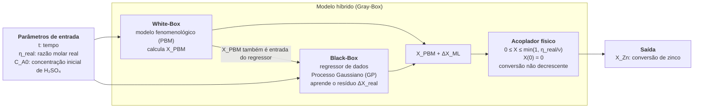

# MODELAGEM HÍBRIDA PARALELA COOPERATIVA: APRENDIZADO DO RESÍDUO

> Rascunho da Seção 4.5 do relatório (substitui "MODELAGEM HÍBRIDA PARALELA: XX"). Só metodologia; resultados na Seção 5.
> Não repete a base de dados (4.1), o White-Box (4.2), a rede da Seção 4.3, a PINN (4.4) nem o híbrido serial (4.6). Numerações 4.X.X e 3.XX são provisórias.

---

Na arquitetura paralela cooperativa descrita na Seção 3.4.2, o modelo de primeiros princípios fornece uma previsão e um modelo orientado por dados aprende a diferença entre essa previsão e o valor observado (Sansana et al., 2024). Neste trabalho, o modelo fenomenológico não é alterado: o aprendizado de máquina atua apenas sobre a sua saída, o que mantém o White-Box como referência interpretável e permite medir, de forma isolada, quanto a correção acrescenta.

## 4.5.1 Justificativa da arquitetura

A escolha seguiu o critério de Sansana et al. (2024): a arquitetura cooperativa é indicada quando o modelo mecanicista tem limitações estruturais conhecidas, mas bom comportamento geral, e o processo opera em domínio conhecido e controlado. As duas condições valem aqui. O White-Box da Seção 4.2 reproduz a forma das curvas de conversão, mas apresenta desvios sistemáticos, o mais evidente sendo o patamar de conversão observado para $\eta \approx 1$, que o balanço populacional não explica. Além disso, os 16 ensaios cobrem um planejamento fixo, com quatro níveis de $\eta$ e de $C_{A0}$, a 40 °C e 1000 rpm.

Entre as arquiteturas da revisão, a serial é tratada em separado na Seção 4.6: ela atua sobre a taxa de retração dentro do balanço populacional e exige um problema inverso para obter essa taxa, sendo uma abordagem distinta e complementar a esta. A arquitetura competitiva (Seção 3.4.2.3), em que o White-Box e o modelo de dados estimam a mesma variável e são combinados por média ponderada, não foi implementada neste trabalho. Como o erro do White-Box depende da condição operacional (é maior perto de $\eta \approx 1$), a cooperativa, que corrige o desvio condição a condição, foi considerada mais adequada; a competitiva fica como possibilidade de trabalho futuro.

A principal limitação da cooperativa, também apontada por Sansana et al. (2024), é que a correção aprendida não obedece às restrições do modelo físico e pode perder consistência fora da região de treino. Por isso o método tem dois elementos centrais, desenvolvidos a seguir: um regressor com comportamento controlado longe dos dados e um acoplador que impõe a física sobre a saída.

## 4.5.2 Formulação

A conversão híbrida é

$$X_{Zn}(t) = \mathcal{R}\left[X_{PBM}(t) + \Delta X_{ML}(t,\ \eta_{real},\ C_{A0},\ X_{PBM})\right] \tag{4.X.X}$$

em que $X_{PBM}$ é a conversão do White-Box, $\Delta X_{ML}$ é a correção estimada pelo regressor e $\mathcal{R}[\cdot]$ é o operador de restrições físicas (Seção 4.5.5). O regressor é treinado sobre o alvo residual

$$\Delta X_{real,ij} = X^{exp}_{Zn,ij} - X_{PBM,ij} \tag{4.X.X}$$

para o ensaio $i$ e o instante $t_j$. O White-Box usado é o de laboratório (Seção 4.2), sem parâmetro ajustado a conversões ou pH. Assim, toda a informação experimental entra apenas pelo resíduo, e $\Delta X_{real}$ mede o quanto o modelo fenomenológico erra quando é construído apenas a partir de literatura e caracterização do material.

Os atributos de entrada são $t$, $\eta_{real}$, $C_{A0}$ e $X_{PBM}$. A razão molar real $\eta_{real}$ (Eq. 4.3, calculada pelas massas e volumes efetivos) foi preferida ao nível nominal porque é ela que limita estequiometricamente a conversão. A temperatura e a agitação não entram, por serem constantes na base. A conversão $X_{PBM}$ informa ao regressor em que ponto da curva a teoria está operando, de modo que a correção depende do estado do processo e não só das condições operacionais. Em teste de ablação, a inclusão de $X_{PBM}$ reduziu o erro em relação ao conjunto $(t, \eta_{real}, C_{A0})$, sobretudo em extrapolação, e a inclusão adicional da concentração de ácido do White-Box não trouxe melhora (critério: empate estatístico favorece o conjunto mais simples).

A Figura 4.X.3 resume a estrutura do modelo: as entradas, o White-Box, o regressor de dados (*black-box*), o acoplador físico e o modelo híbrido (*gray-box*) que os reúne. Os componentes são detalhados nas seções seguintes.

**Figura 4.X.3** – Estrutura do modelo híbrido paralelo cooperativo: o White-Box calcula a conversão fenomenológica, o regressor de dados estima a correção e o acoplador físico impõe as restrições à soma das duas
*Fonte: Elaborado pelos autores (2026)*

## 4.5.3 Regressor: Processo Gaussiano

O regressor adotado foi o processo gaussiano (GP), por três razões: (i) a média nula a priori faz a correção tender a zero longe dos dados, de modo que o modelo híbrido volta ao White-Box onde não há informação; (ii) ele fornece incerteza preditiva analítica, sem procedimento adicional; e (iii) é adequado a bases pequenas, como os 16 ensaios disponíveis.

O processo gaussiano (GP) modela o resíduo como uma função aleatória $\Delta X_{real}(\mathbf{x}) \sim \mathcal{GP}(0, k(\mathbf{x}, \mathbf{x}'))$ com média nula a priori (Rasmussen; Williams, 2006). A média nula é a propriedade central para este uso: onde não há dados, a previsão do resíduo tende a zero e o modelo híbrido tende ao White-Box, que é o comportamento desejável em uma correção.

A função de covariância adotada foi o núcleo de Matérn (Rasmussen; Williams, 2006) com $\nu = 3/2$ e escalas de comprimento independentes por atributo (ARD), somado a um termo de ruído branco:

$$k(\mathbf{x},\mathbf{x}') = \sigma_f^2\left(1+\sqrt{3}\,r\right)e^{-\sqrt{3}\,r} + \sigma_n^2\,\delta_{\mathbf{x}\mathbf{x}'}, \qquad r=\sqrt{\sum_{d=1}^{4}\frac{(x_d-x'_d)^2}{\ell_d^2}} \tag{4.X.X}$$

O Matérn 3/2 produz funções uma vez diferenciáveis, menos suaves que o núcleo gaussiano, o que é mais adequado a curvas de conversão que mudam rapidamente nos primeiros minutos. Cada $\ell_d$ indica a sensibilidade do resíduo ao atributo $d$, e $\sigma_n^2$ absorve o ruído experimental. Os hiperparâmetros $(\sigma_f, \ell_d, \sigma_n)$ foram obtidos maximizando a verossimilhança marginal (Rasmussen; Williams, 2006), com cinco reinícios do otimizador para reduzir o risco de mínimos locais. O tempo entra como $\log(1+t)$, porque a cinética é muito mais rápida no início, e os atributos e o alvo são padronizados.

Dado o conjunto de treino, a previsão em um novo ponto $\mathbf{x}_*$ é gaussiana, com média $\mu_*$ e variância $\sigma_*^2$ analíticas:

$$\mu_* = \mathbf{k}_*^\top \mathbf{K}^{-1}\mathbf{y}, \qquad \sigma_*^2 = k(\mathbf{x}_*,\mathbf{x}_*) - \mathbf{k}_*^\top \mathbf{K}^{-1}\mathbf{k}_* \tag{4.X.X}$$

em que $\mathbf{K}$ é a matriz de covariância dos pontos de treino (incluindo $\sigma_n^2$) e $\mathbf{k}_*$ o vetor de covariâncias com $\mathbf{x}_*$. Esse desvio-padrão fornece o intervalo de predição sem procedimento adicional e cresce longe dos dados, sinalizando a extrapolação.

Outros regressores (Extra Trees, Geurts; Ernst; Wehenkel, 2006; Random Forest, Breiman, 2001; *Gradient Boosting*; SVR; e MLP) foram avaliados como análise de sensibilidade, com os mesmos atributos e o mesmo protocolo, e estão no Apêndice B. Eles não alteram a metodologia, apenas verificam se a conclusão depende da escolha do regressor.

## 4.5.4 Baselines

Para separar o que a física acrescenta do que o ML faria sozinho, o híbrido é comparado com:

* **White-Box sozinho**, que define o erro de referência;
* **Tabela por $(\eta, t)$**: média dos ensaios de treino no mesmo nível de $\eta$ e instante, baseline só de dados e sem ML;
* **Caixa-preta**: o mesmo GP, mesmos atributos exceto $X_{PBM}$, prevendo $X_{Zn}$ diretamente, e passando pelo mesmo acoplador físico. É a comparação que isola o efeito de informar a física.

## 4.5.5 Acoplador físico

O regressor não conhece a estequiometria nem a condição inicial, e a soma $X_{PBM} + \Delta X_{ML}$ pode violá-las. O operador $\mathcal{R}[\cdot]$ projeta a saída, para cada ensaio, em três restrições.

A primeira é o limite estequiométrico. O ácido sulfúrico é o reagente limitante quando $\eta < 1$ e é consumido na proporção $\nu$ mol por mol de ZnO. Logo, a conversão máxima é

$$X_{max} = \min\left(1,\ \frac{\eta_{real}}{\nu}\right) \tag{4.X.X}$$

com $\nu = 1$ no White-Box de laboratório, de modo que a restrição seja coerente com o balanço de ácido do modelo físico. Em versão anterior do trabalho, o teto usava o $\eta$ nominal e funcionava como correção oculta, equivalente a um $\nu \approx 1{,}07$; por isso passou a usar $\eta_{real}/\nu$ declarado.

A segunda é a condição inicial, $X(0) = 0$, que é conhecida e não precisa ser aprendida.

A terceira é a monotonicidade: a conversão não decresce com o tempo. Ela é imposta pela projeção, em mínimos quadrados, da curva do ensaio sobre as funções não decrescentes, a chamada regressão isotônica (Barlow et al., 1972):

$$\min_{\mathbf{z}}\ \sum_{j}\left(X_{b,j} - z_j\right)^2 \quad \text{s.a.}\quad 0\le z_1\le z_2\le\dots\le z_n \le X_{max} \tag{4.X.X}$$

em que $X_{b,j}$ é a saída bruta do modelo (soma $X_{PBM} + \Delta X_{ML}$, antes das restrições) no instante $j$ e $z_j$ é a conversão após a projeção. A alternativa mais comum, o máximo acumulado, foi descartada porque é viesada para cima e depende da ordem dos pontos.

As restrições são aplicadas sobre a saída bruta, e esta é auditada antes da projeção (fração de pontos acima de $X_{max}$, abaixo de zero e passos decrescentes). Isso permite separar o que o regressor aprendeu de física daquilo que apenas o acoplador corrigiu. O modelo também guarda o domínio de treino ($t$, $\eta_{real}$, $C_{A0}$) e avisa quando uma previsão está fora dele.

## 4.5.6 Validação

Os 16 ensaios (128 pontos, médias de triplicatas) têm 8 instantes cada, e pontos do mesmo ensaio são fortemente correlacionados. Por isso todas as partições foram feitas **por ensaio inteiro**, com o White-Box recalculado em cada dobra, para evitar vazamento de dados entre treino e teste (Kapoor; Narayanan, 2023). As métricas foram calculadas apenas em $t > 0$, já que os pontos em $t=0$ são triviais. Um teste automatizado confirma que trocar os dados medidos dos ensaios de teste não altera a previsão.

Três protocolos sustentam as conclusões:

| Protocolo | Procedimento | O que mede |
| :--- | :--- | :--- |
| LOGO (*Leave-One-Group-Out*) | 15 ensaios de treino, 1 de teste, em rodízio | interpolação |
| Deixa-um-$\eta$-fora | retira de uma vez todos os ensaios de um nível de $\eta$ | extrapolação em $\eta$ |
| Curva de aprendizado | 4, 8 e 14 ensaios de treino, 30 sorteios | dependência do tamanho da base |

## 4.5.7 Implementação

O código foi escrito em Python, com a biblioteca scikit-learn (Pedregosa et al., 2011). O modelo híbrido está em `hybrid_model.py`, e os protocolos, baselines e estatística em `validacao.py`. O pipeline completo é executado por `experimentos_batelada.py`, e os números e figuras do relatório são gerados a partir dos arquivos de saída, sem digitação manual.

---

### Notas para você (apagar antes de colar no relatório)

* **Apêndice B:** criar com os quatro regressores restantes e os três protocolos extras. A fonte é `resultados/*.csv` e a seção 6 de `docs/validade_modelo_hibrido.md` (atenção: 6.1 a 6.6 têm números da versão anterior do White-Box; o principal atual está na 6.0).
* **Conferir:** "$\nu \approx 1{,}07$" para o teto antigo vem da seção 2 do `docs/validade_modelo_hibrido.md`; "Eq. 4.3" para $\eta_{real}$ deve bater com a numeração final; o 4.X.X do GP e do acoplador também.
* **Afirmações que dependem dos resultados:** a frase da ablação (conjunto B reduziu erro, C empatou) é hipótese de leitura; confirme na seção 6.0 do `docs/validade_modelo_hibrido.md`. **Atenção ao tirar o Extra Trees:** era ele o híbrido significativamente melhor que a caixa-preta em interpolação. Com o GP, os dois empatam em interpolação (GKF8 × 20: 0,0223 contra 0,0239). Em extrapolação em η o GP híbrido (0,0672) ainda fica bem abaixo da caixa-preta GP (0,0978), mas **acima da tabela por (η, t)** (0,0637) e do próprio Extra Trees (0,0644). Isso precisa aparecer na discussão: o ganho do híbrido está na extrapolação e com poucos dados, não na interpolação.
* **Citações:** já estão no texto. Acrescente as referências abaixo à lista da Seção 7. Já existem na lista do relatório: Sansana et al. (2024) e Breiman (2001). Não encontrei na lista atual Kapoor e Narayanan (2023) nem Chicco et al. (2021), que o relatório já cita no texto; confira e inclua se faltarem. Escrevi as referências de memória, então **confira autores, volume e páginas** (Google Acadêmico ou DOI) antes de fechar.

#### Referências a acrescentar (ABNT)

BARLOW, R. E.; BARTHOLOMEW, D. J.; BREMNER, J. M.; BRUNK, H. D. Statistical Inference under Order Restrictions: The Theory and Application of Isotonic Regression. London: Wiley, 1972.

CHICCO, D.; WARRENS, M. J.; JURMAN, G. The coefficient of determination R-squared is more informative than SMAPE, MAE, MAPE, MSE and RMSE in regression analysis evaluation. PeerJ Computer Science, v. 7, e623, 2021.

EFRON, B.; TIBSHIRANI, R. J. An Introduction to the Bootstrap. New York: Chapman & Hall, 1993.

GEURTS, P.; ERNST, D.; WEHENKEL, L. Extremely randomized trees. Machine Learning, v. 63, n. 1, p. 3–42, 2006.

KAPOOR, S.; NARAYANAN, A. Leakage and the reproducibility crisis in machine-learning-based science. Patterns, v. 4, n. 9, 100804, 2023.

PEDREGOSA, F. et al. Scikit-learn: Machine learning in Python. Journal of Machine Learning Research, v. 12, p. 2825–2830, 2011.

RASMUSSEN, C. E.; WILLIAMS, C. K. I. Gaussian Processes for Machine Learning. Cambridge: MIT Press, 2006.

* **Alinhar com a 4.3:** a rede da 4.3 usa 13/3 ensaios; aqui a validação é por grupos. Vale combinar com quem escreveu a 4.3.
* **Ressalva a declarar:** $k_s$ de Balarini foi estimado com $C_A=[H^+]$ a 30 °C e aqui multiplica a concentração de H₂SO₄ livre, como na tese.
