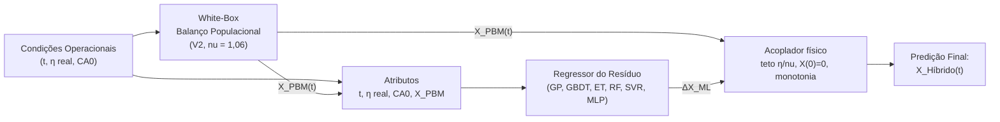

# Proposta de Arquitetura da Solução: Do Modelo White-Box ao Modelo Híbrido Grey-Box

**Laboratório de Operações e Processos -- Engenharia Química -- UFMG**  
**Alunos:** Daniel Couto Vieira, Guilherme Moura de Sousa Franco, Matheus Henrique Borba Póvoas, Rodrigo Amaral da Mata  
**Orientador:** Prof. Dr. Fabrício Eduardo Bortot Coelho  
**Data:** Outubro de 2026  

> Escopo: **só a batelada**. A validação completa, os resultados e as limitações estão em [`docs/validade_modelo_hibrido.md`](../docs/validade_modelo_hibrido.md); todas as tabelas `T##` vêm de `resultados/tabelas.md`.

---
## 1. Status Atual

Estrutura em Python que reproduz as equações de conservação e balanço populacional, o modelo híbrido e a sua validação:

```
scripts/
├── data_loader.py              <- 128 pontos (Tabelas A1.1 e A1.4) e respostas finais (pH, X final)
├── kinetics.py                 <- ConfigWB; cinética; K2(T); par iônico ZnSO4; fator nu
├── population_balance.py       <- PBM por características, RRB mássica (integrador de referência e rápido)
├── hybrid_model.py             <- atributos A/B/C, acoplador físico, catálogo de regressores, ModeloHibridoCinza
├── validacao.py                <- protocolos, baselines (tabela, Ridge, caixa-preta), métricas, bootstrap, intervalos
├── experimentos_batelada.py    <- PIPELINE ÚNICO: gera resultados/*.csv
├── figuras_batelada.py         <- resultados/figuras/*.png
└── tabelas_batelada.py         <- resultados/tabelas.md
```

### White-Box principal ($k_s(T)$, $[\text{H}^+]$ com $K_2(T)$ e par iônico $\text{ZnSO}_4^0$, $\nu = 1{,}06$, $\alpha = 0$)
*(Modelo de Bortot Coelho (2017) com correções de consistência física; ver `docs/modelagem_white_box.md`. Nenhum parâmetro é ajustado aos 128 pontos.)*
* **$R^2$ global (128 pontos):** **$0{,}9680$**; **$0{,}8992$** excluindo os 16 pontos triviais em $t = 0$ (RMSE $0{,}0620$; o piso de ruído experimental é $0{,}0175$).
* **Referências:** o White-Box **anterior** à revisão ($K_2 = 0{,}0099$ constante, $\nu = 1$) tinha $R^2 = 0{,}9837$ ($0{,}9486$ com $t > 0$; RMSE $0{,}0443$); a formulação original da tese, $0{,}9198$ ($0{,}7475$) com $\alpha = 0$ e $0{,}9268$ ($0{,}7697$) com $\alpha = 5500$ (T02).
* **Por que ele ajusta pior que o anterior:** o $K_2$ constante reduzia o $[\text{H}^+]$ e absorvia parte do patamar em $\eta \approx 1$ que a física não explica. Só o novo é coerente com o **pH final medido** (RMSE de pH $0{,}26$ contra $0{,}99$; T03).
* **Consistência física:** o acoplador impõe $0 \le X \le \min(1;\ \eta_{real}/\nu)$, $X(0) = 0$ e $dX/dt \ge 0$ (regressão isotônica) e **audita a saída bruta** do ML (seção 3.3).

### 1.1 Tabela de Conversões Experimentais ($X_{\text{Zn}}^{\text{exp}}$)
*(Dados das Tabelas A1.1 e A1.4 da dissertação de Fabrício Bortot Coelho, 2017; médias de triplicatas)*

| Ensaio | η | CA0 (mol/L) | 0 min | 0,5 min | 1 min | 2 min | 3 min | 4 min | 5 min | 15 min |
| :---: | :---: | :---: | :---: | :---: | :---: | :---: | :---: | :---: | :---: | :---: |
| **1** | 0,5 | 0,1 | 0,00 | 0,42 | 0,46 | 0,46 | 0,49 | 0,51 | 0,49 | 0,50 |
| **2** | 3,1 | 0,1 | 0,00 | 0,82 | 0,90 | 0,95 | 0,97 | 0,97 | 0,99 | 1,00 |
| **3** | 0,5 | 0,5 | 0,00 | 0,45 | 0,48 | 0,49 | 0,52 | 0,50 | 0,49 | 0,50 |
| **4** | 0,5 | 1,0 | 0,00 | 0,50 | 0,47 | 0,51 | 0,47 | 0,53 | 0,51 | 0,50 |
| **5** | 0,5 | 1,5 | 0,00 | 0,49 | 0,49 | 0,47 | 0,49 | 0,49 | 0,47 | 0,49 |
| **6** | 1,0 | 0,1 | 0,00 | 0,75 | 0,78 | 0,80 | 0,85 | 0,87 | 0,85 | 0,87 |
| **7** | 3,1 | 0,5 | 0,00 | 0,88 | 0,93 | 0,98 | 0,99 | 1,00 | 0,99 | 1,01 |
| **8** | 1,0 | 0,5 | 0,00 | 0,83 | 0,82 | 0,85 | 0,86 | 0,87 | 0,86 | 0,87 |
| **9** | 1,0 | 1,0 | 0,00 | 0,83 | 0,84 | 0,85 | 0,85 | 0,83 | 0,84 | 0,85 |
| **10** | 1,0 | 1,5 | 0,00 | 0,84 | 0,83 | 0,83 | 0,83 | 0,83 | 0,84 | 0,85 |
| **11** | 1,5 | 0,1 | 0,00 | 0,86 | 0,85 | 0,88 | 0,97 | 0,94 | 0,96 | 0,98 |
| **12** | 3,1 | 1,0 | 0,00 | 0,96 | 1,00 | 1,00 | 0,99 | 0,99 | 0,99 | 1,00 |
| **13** | 1,5 | 0,5 | 0,00 | 0,92 | 0,92 | 0,95 | 0,95 | 0,95 | 0,95 | 0,97 |
| **14** | 1,5 | 1,0 | 0,00 | 0,91 | 0,96 | 0,95 | 0,97 | 0,95 | 0,98 | 0,97 |
| **15** | 1,5 | 1,5 | 0,00 | 0,91 | 0,94 | 0,95 | 0,94 | 0,96 | 0,96 | 0,97 |
| **16** | 3,1 | 1,5 | 0,00 | 0,98 | 0,98 | 0,96 | 0,99 | 0,99 | 1,00 | 1,00 |

### 1.2 Tabela de Conversões do White-Box Principal ($X_{\text{PBM}}$)
*(Conversão da zincita, mesma base de $X_{\text{Zn}}^{\text{exp}}$, via Balanço Populacional com $\alpha = 0$ e $\nu = 1{,}06$. Com $\eta = 0{,}5$ o patamar é $\eta_{real}/\nu = 0{,}50$.)*

| Ensaio | η | C_A0 | 0 min | 0,5 min | 1 min | 2 min | 3 min | 4 min | 5 min | 15 min |
| :--- | ---: | ---: | ---: | ---: | ---: | ---: | ---: | ---: | ---: | ---: |
| 1 | 0,5 | 0,1 | 0,00 | 0,48 | 0,50 | 0,50 | 0,50 | 0,50 | 0,50 | 0,50 |
| 2 | 3,1 | 0,1 | 0,00 | 0,88 | 0,96 | 0,99 | 1,00 | 1,00 | 1,00 | 1,00 |
| 3 | 0,5 | 0,5 | 0,00 | 0,50 | 0,50 | 0,50 | 0,50 | 0,50 | 0,50 | 0,50 |
| 4 | 0,5 | 1,0 | 0,00 | 0,50 | 0,50 | 0,50 | 0,50 | 0,50 | 0,50 | 0,50 |
| 5 | 0,5 | 1,5 | 0,00 | 0,50 | 0,50 | 0,50 | 0,50 | 0,50 | 0,50 | 0,50 |
| 6 | 1,0 | 0,1 | 0,00 | 0,72 | 0,81 | 0,87 | 0,90 | 0,92 | 0,93 | 0,97 |
| 7 | 3,1 | 0,5 | 0,00 | 1,00 | 1,00 | 1,00 | 1,00 | 1,00 | 1,00 | 1,00 |
| 8 | 1,0 | 0,5 | 0,00 | 0,86 | 0,91 | 0,94 | 0,95 | 0,96 | 0,97 | 0,99 |
| 9 | 1,0 | 1,0 | 0,00 | 0,90 | 0,93 | 0,96 | 0,97 | 0,97 | 0,98 | 0,99 |
| 10 | 1,0 | 1,5 | 0,00 | 0,92 | 0,94 | 0,96 | 0,97 | 0,98 | 0,98 | 0,99 |
| 11 | 1,5 | 0,1 | 0,00 | 0,80 | 0,90 | 0,96 | 0,98 | 0,99 | 1,00 | 1,00 |
| 12 | 3,1 | 1,0 | 0,00 | 1,00 | 1,00 | 1,00 | 1,00 | 1,00 | 1,00 | 1,00 |
| 13 | 1,5 | 0,5 | 0,00 | 0,97 | 0,99 | 1,00 | 1,00 | 1,00 | 1,00 | 1,00 |
| 14 | 1,5 | 1,0 | 0,00 | 0,99 | 1,00 | 1,00 | 1,00 | 1,00 | 1,00 | 1,00 |
| 15 | 1,5 | 1,5 | 0,00 | 1,00 | 1,00 | 1,00 | 1,00 | 1,00 | 1,00 | 1,00 |
| 16 | 3,1 | 1,5 | 0,00 | 1,00 | 1,00 | 1,00 | 1,00 | 1,00 | 1,00 | 1,00 |

### 1.3 Tabela de Resíduos Sistemáticos ($\Delta X = X_{\text{Zn}}^{\text{exp}} - X_{\text{PBM}}$)
*(O que o Machine Learning aprende no Grey-Box. Concentra-se em $\eta = 1$: $-0{,}10$ a $-0{,}14$ aos 15 min.)*

| Ensaio | η | C_A0 | 0 min | 0,5 min | 1 min | 2 min | 3 min | 4 min | 5 min | 15 min |
| :--- | ---: | ---: | ---: | ---: | ---: | ---: | ---: | ---: | ---: | ---: |
| 1 | 0,5 | 0,1 | 0,00 | -0,06 | -0,04 | -0,04 | -0,01 | 0,01 | -0,01 | -0,00 |
| 2 | 3,1 | 0,1 | 0,00 | -0,06 | -0,06 | -0,04 | -0,03 | -0,03 | -0,01 | 0,00 |
| 3 | 0,5 | 0,5 | 0,00 | -0,05 | -0,02 | -0,01 | 0,02 | -0,00 | -0,01 | -0,00 |
| 4 | 0,5 | 1,0 | 0,00 | -0,00 | -0,03 | 0,01 | -0,03 | 0,03 | 0,01 | -0,00 |
| 5 | 0,5 | 1,5 | 0,00 | -0,01 | -0,01 | -0,03 | -0,01 | -0,01 | -0,03 | -0,01 |
| 6 | 1,0 | 0,1 | 0,00 | 0,03 | -0,03 | -0,07 | -0,05 | -0,05 | -0,08 | -0,10 |
| 7 | 3,1 | 0,5 | 0,00 | -0,12 | -0,07 | -0,02 | -0,01 | 0,00 | -0,01 | 0,01 |
| 8 | 1,0 | 0,5 | 0,00 | -0,03 | -0,09 | -0,09 | -0,09 | -0,09 | -0,11 | -0,12 |
| 9 | 1,0 | 1,0 | 0,00 | -0,07 | -0,09 | -0,11 | -0,12 | -0,14 | -0,14 | -0,14 |
| 10 | 1,0 | 1,5 | 0,00 | -0,08 | -0,11 | -0,13 | -0,14 | -0,15 | -0,14 | -0,14 |
| 11 | 1,5 | 0,1 | 0,00 | 0,06 | -0,05 | -0,08 | -0,01 | -0,05 | -0,04 | -0,02 |
| 12 | 3,1 | 1,0 | 0,00 | -0,04 | 0,00 | 0,00 | -0,01 | -0,01 | -0,01 | 0,00 |
| 13 | 1,5 | 0,5 | 0,00 | -0,05 | -0,07 | -0,05 | -0,05 | -0,05 | -0,05 | -0,03 |
| 14 | 1,5 | 1,0 | 0,00 | -0,08 | -0,04 | -0,05 | -0,03 | -0,05 | -0,02 | -0,03 |
| 15 | 1,5 | 1,5 | 0,00 | -0,09 | -0,06 | -0,05 | -0,06 | -0,04 | -0,04 | -0,03 |
| 16 | 3,1 | 1,5 | 0,00 | -0,02 | -0,02 | -0,04 | -0,01 | -0,01 | 0,00 | 0,00 |

---

## 2. Justificativa

Na dissertação de 2017, para representar a desaceleração da lixiviação, foi introduzido um termo experimental na velocidade de dissolução:
$$v(t) = \frac{2}{\rho_s} \big[ k_s C_{Af}(t) - \alpha (C_{A0} - C_{Af}(t)) \big]$$
com o ajuste de $\alpha = 5500\ \mu\text{m/min}$.

### A Oportunidade Identificada
Esse parâmetro concentra **de forma única** fenômenos que variam ao longo da reação. Sem ele, e com as correções do White-Box, o resíduo (Tabela 1.3) tem as assinaturas:
1. **Patamar incompleto com $\eta = 1$:** o modelo chega a $0{,}97$--$0{,}99$ e o experimento para em $0{,}85$--$0{,}87$ (resíduo $-0{,}10$ a $-0{,}14$), mesmo com $[\text{H}^+]$ de $0{,}06$ a $0{,}25$ mol/L no fim (pH medido $0{,}6$ a $1{,}2$). Esse patamar **não** parece limitado pela acidez; a causa é desconhecida (hipóteses: zinco ocluído ou refratário, passivação por $\text{CaSO}_4$/$\text{PbSO}_4$, íon comum e atividade, base de cálculo da Eq. 4.5). É o efeito que $\alpha$ tentava representar.
2. **Transientes iniciais ($t = 0{,}5$ min):** de $-0{,}12$ a $+0{,}06$, de sinal variável.
3. **Patamar com $\eta = 0{,}5$:** com o fator $\nu$ (consumo de ácido por outros constituintes da calcina), o modelo para em $0{,}50$ e o resíduo é $\le 0{,}014$ em módulo.

*(O modelo com $\alpha = 5500$ não resolve isso: ele para em $0{,}41$ com $\eta = 0{,}5$, deixando 23% do ácido sem reagir, enquanto o experimento consome todo o ácido e chega a $0{,}50$.)*

### A Proposta do Nosso LOP
Em vez de depender de um parâmetro de ajuste fixo ($\alpha$), **mantemos o White-Box com $\alpha = 0$** e usamos a **Modelagem Híbrida**: o Machine Learning aprende o desvio do modelo teórico,
$$\Delta X(t) = X_{\text{experimental}}(t) - X_{\text{PBM}}(t)$$
e **a validade desse híbrido é demonstrada contra baselines e em extrapolação**, não só em interpolação (seção 4).

---

## 3. Arquitetura do Modelo Grey-Box

Arquitetura **paralela cooperativa** (Sansana et al., 2024): o modelo de primeiros princípios descreve o comportamento geral, tem uma limitação estrutural (o patamar em $\eta \approx 1$) e o domínio é conhecido e controlado.

<div align="center">



</div>

### 3.1. Adaptabilidade do modelo
Uma vantagem da arquitetura híbrida sobre redes neurais puras é a **sensibilidade granulométrica herdada**: uma calcina mais fina ($D_{63{,}2} = 25\ \mu\text{m}$) ou mais grossa ($60\ \mu\text{m}$) é recalculada pelo White-Box (momento volumétrico e dissolução de cada classe) sem retreinar o algoritmo; o ML atua sobre o resíduo condicionado à nova previsão. **Cuidado:** isso só vale se o resíduo aprendido continuar valendo para a nova calcina, o que **não foi testado** (só há uma calcina).

### 3.2. Atributos de Entrada do ML
O ML recebe condições operacionais e a conversão calculada pela física. Foram avaliados três conjuntos (ablação, T10):

| Conjunto | Atributos | Observação |
| :---: | :--- | :--- |
| **A** | $t$, $\eta_{real}$, $C_{A0}$ | só as variáveis independentes do planejamento (sem física) |
| **B (adotado)** | A + $X_{\text{PBM}}(t)$ | o ML "vê" onde a teoria opera |
| **C** | B + $C_{Af,\text{PBM}}$ + $[\text{H}^+]_{\text{PBM}}$ | empata com B; vale o mais simples |

Informar $X_{\text{PBM}}$ reduz o erro frente ao conjunto A, sobretudo na extrapolação em $\eta$ (GBDT $0{,}0634 \to 0{,}0432$; Extra Trees $0{,}0638 \to 0{,}0450$). A razão sólido-líquido foi retirada (é função exata de $C_{A0}/\eta$) e usa-se o $\eta$ **real** (Eq. 4.3), não o nível nominal.

### 3.3. O Papel do Acoplador
O acoplador aplica as restrições à saída **bruta** do modelo ($X_{raw} = X_{\text{PBM}} + \widehat{\Delta X}_{ML}$):
1. **Limites e estequiometria:** $0 \le X \le \min(1;\ \eta_{real}/\nu)$, o mesmo teto do PBM. O teto da versão anterior usava o $\eta$ **nominal** (0,5) contra o $\eta$ real do PBM (0,535): era uma correção oculta (equivalente a $\nu = 1{,}07$) que reduzia o RMSE do White-Box de $0{,}0443$ para $0{,}0415$.
2. **Condição inicial:** $X(0) = 0$.
3. **Monotonia** $dX/dt \ge 0$ por ensaio, pela projeção L2 (regressão isotônica), não pelo máximo acumulado (viesado para cima).
4. **Auditoria:** a "violação 0%" da versão anterior era medida *depois* do clip. Agora se reporta a violação na **saída bruta**: por exemplo, em GKF8 × 20, a caixa-preta GP viola o teto em 16% dos pontos e tem 24% de passos decrescentes; o híbrido GP, 9,6% e 3,7% (T05).

---

## 4. Metodologia

### Etapa 1: White-Box com proveniência
Todo parâmetro tem fonte independente dos 128 pontos (RRB, $k_s$, $E_a$, $K_2(T)$, $K_z(T)$, $\nu$). A variante de especiação (V0, V1 ou V2) é escolhida pela **regra do pH medido**; $\nu$ é estimado a priori pela composição da calcina ($1{,}06$) ou, nas dobras de CV, só com ensaios de treino.

### Etapa 2: Catálogo e baselines
* **Híbridos** (resíduo): GP (Matérn 3/2 ARD), Extra Trees, GBDT, Random Forest, SVR e MLP tanh (SVR e MLP com hiperparâmetros por **CV aninhada**).
* **Baselines:** White-Box sozinho; **tabela** (resíduo médio por $\eta$ e $t$, sem ML); Ridge; **caixa-preta** (o mesmo regressor prevendo $X$ direto, sem física). O híbrido só é válido onde supera todos.

### Etapa 3: Validação por ensaio inteiro (6 protocolos)
GroupKFold(8) do TCC e **20 partições aleatórias**; **LOGO**; **deixa-um-nível-de-$\eta$-fora** (extrapolação em $\eta$); deixa-um-nível-de-$C_{A0}$-fora; **extrapolação temporal** (treina $t \le 5$ min, prevê 15 min); **curva de aprendizado** (4 a 14 ensaios de treino). O PBM é recalculado em cada dobra e um teste automático garante que trocar os dados medidos dos ensaios de teste não altera nenhuma previsão (sem vazamento).

### Etapa 4: Métricas
Só em $t > 0$: RMSE, MAE, viés, $R^2$; **ganho** sobre o White-Box $= 1 - \text{MSE}/\text{MSE}_{WB}$ e seu **teto** pelo piso de ruído $\sigma = 0{,}0175$ ($0{,}913$); IC95% por **bootstrap de ensaios**; comparações pareadas com empates declarados; cobertura dos intervalos de predição.

---

## 5. Resultados (resumo; detalhes em `docs/validade_modelo_hibrido.md`)

### 5.1 Interpolação: GroupKFold × 20 partições (RMSE em $t > 0$; $\sigma = 0{,}0175$)

| Modelo | Tipo | RMSE (± dp entre partições) | % do ganho máximo |
| :--- | :--- | :---: | :---: |
| **Híbrido MLP** | híbrido | **0,0196 ± 0,0017** | 97 |
| **Híbrido GBDT** | híbrido | 0,0209 ± 0,0009 | 96 |
| Híbrido Random Forest | híbrido | 0,0219 ± 0,0009 | 95 |
| Híbrido GP | híbrido | 0,0224 ± 0,0012 | 94 |
| Híbrido Extra Trees | híbrido | 0,0230 ± 0,0007 | 93 |
| Caixa-preta GP | só ML | 0,0234 ± 0,0012 | 92 |
| Caixa-preta GBDT | só ML | 0,0238 ± 0,0010 | 92 |
| Tabela (η, t) | sem ML | 0,0306 ± 0,0009 | 80 |
| Ridge (resíduo) | linear | 0,0388 ± 0,0013 | 63 |
| *White-Box principal* | física | *0,0594 ± 0,0004* | *0* |

### 5.2 Extrapolação em $\eta$ (um nível inteiro de $\eta$ ausente do treino)

| Modelo | RMSE | Ganho vs White-Box |
| :--- | :---: | :---: |
| **Híbrido Random Forest** | **0,0417** | 0,51 |
| Híbrido GBDT | 0,0432 | 0,47 |
| Híbrido Extra Trees | 0,0450 | 0,43 |
| Ridge (resíduo) | 0,0507 | 0,27 |
| Tabela (η, t) | 0,0527 | 0,22 |
| Híbrido GP | 0,0536 | 0,19 |
| *White-Box principal* | *0,0595* | *0* |
| Caixa-preta Extra Trees / GBDT / GP | 0,0727 / 0,0758 / 0,0950 | negativo |


### 5.3 O que se conclui
1. **Interpolação:** os híbridos chegam a $0{,}019$--$0{,}023$ (1,1 a 1,3σ), **mas uma caixa-preta já fica em $0{,}023$--$0{,}024$**: as diferenças pareadas com o mesmo modelo são empates (GP, GBDT) ou marginais (Extra Trees). A física pouco acrescenta onde há dados em volta.
2. **Extrapolação em $\eta$:** os híbridos de árvore erram 24 a 30% menos que o White-Box, e **toda** caixa-preta fica pior que ele. A física é o que permite extrapolar.
3. **Poucos dados:** com 4 ensaios de treino o melhor híbrido erra $0{,}039$ contra $0{,}086$ da melhor caixa-preta (2×); com 14, $0{,}021$ contra $0{,}023$.
4. **Domínio:** os **4 níveis de $\eta$ ensaiados**, $C_{A0} \in [0{,}1;\ 1{,}5]$ mol/L, $t \le 15$ min, 40 °C. Entre os níveis de $\eta$ os modelos discordam em até $0{,}09$ de conversão, e os intervalos de 95% cobrem só 49 a 71% dos pontos (89 a 91% em LOGO).
5. **Trade-off do White-Box (D2):** o híbrido sobre o White-Box antigo corrigido por $\nu$ (V0 + $\nu$) extrapola melhor em $\eta$ (Extra Trees $0{,}0290$ contra $0{,}0450$), embora seja incoerente com o pH. A escolha deve ser declarada (`validade_modelo_hibrido.md`, seção 6.7).

### 5.4 Reprodução
```powershell
& ..\.venv\Scripts\python.exe -m pytest                              # 56 testes
& ..\.venv\Scripts\python.exe scripts/experimentos_batelada.py       # ~11 min -> resultados/*.csv
& ..\.venv\Scripts\python.exe scripts/figuras_batelada.py            # resultados/figuras/*.png
& ..\.venv\Scripts\python.exe scripts/tabelas_batelada.py            # resultados/tabelas.md
```
