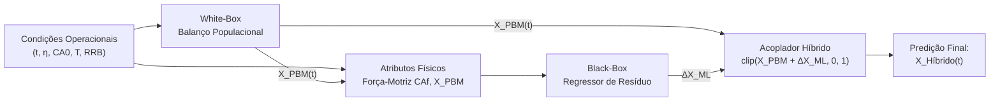

# Proposta de Arquitetura da Solução: Do Modelo White-Box ao Modelo Híbrido Grey-Box

**Laboratório de Operações e Processos -- Engenharia Química -- UFMG**  
**Alunos:** Daniel Couto Vieira, Guilherme Moura de Sousa Franco, Matheus Henrique Borba Póvoas, Rodrigo Amaral da Mata  
**Orientador:** Prof. Dr. Fabrício Eduardo Bortot Coelho  
**Data:** Setembro de 2026  

---
## 1. Status Atual

Desenvolvemos uma estrutura em Python que reproduz as equações de conservação e balanço populacional:

```
scripts/
├── data_loader.py            <- Ingestão padronizada dos 128 pontos (Tabelas A1.1 e A1.4)
├── kinetics.py               <- Cinética de Arrhenius, estequiometria do ácido e taxa v(t)
├── population_balance.py     <- PBM via Método das Características com distribuição RRB
└── diagnostico_residuo.py    <- Execução do PBM e cálculo do resíduo Delta_X
```

### Resultados Obtidos pelo White-Box Puro ($\alpha = 0$):
*(Modelo de Bortot Coelho (2017) com três correções de consistência física: RRB integrada em base mássica, $k_s$ referido a $30^\circ\text{C}$ (Arrhenius até $40^\circ\text{C}$) e força motriz $[\text{H}^+]$ pela especiação $\text{HSO}_4^-/\text{SO}_4^{2-}$, a mesma base em que $k_s$ foi estimado. $\eta$ calculado pelas massas (Eq. 4.3), conversão na base da zincita (Eq. 4.5) e $\alpha = 0$; ver `docs/modelagem_white_box.md`.)*
* **$R^2$ Global (128 pontos):** **$0{,}9837$** (explica $98{,}4\%$ da variância experimental); **$0{,}9486$** excluindo os 16 pontos triviais em $t = 0$.
* **$RMSE$ (Erro Médio Quadrático):** **$0{,}0414$** ($4{,}14\%$).
* **$MAE$ (Erro Médio Absoluto):** **$0{,}0309$** ($3{,}09\%$).
* **Referências:** formulação original da tese com $\alpha = 0$, $R^2 = 0{,}9198$ ($0{,}7475$ com $t > 0$); com $\alpha = 5500$, $R^2 = 0{,}9268$ ($0{,}7697$ com $t > 0$).
* **Consistência Física:** $100\%$ das restrições atendidas ($0 \le X \le 1$ e parada da lixiviação (estado estacionário) quando $\eta < 1{,}0$).

### 1.1 Tabela de Conversões Experimentais ($X_{\text{Zn}}^{\text{exp}}$)
*(Dados das Tabelas A1.1 e A1.4 da dissertação de Fabrício Bortot Coelho, 2017)*

| Ensaio | η | CA0 (mol/L) | 0 min | 0,5 min | 1 min | 2 min | 3 min | 4 min | 5 min | 15 min |
| :---: | :---: | :---: | :---: | :---: | :---: | :---: | :---: | :---: | :---: | :---: |
| **1** | 0,5 | 0,1 | 0,00 | 0,42 | 0,46 | 0,46 | 0,49 | 0,51 | 0,49 | 0,50 |
| **2** | 3,1 | 0,1 | 0,00 | 0,82 | 0,90 | 0,95 | 0,97 | 0,97 | 0,99 | 1,00 |
| **3** | 0,5 | 0,5 | 0,00 | 0,45 | 0,48 | 0,49 | 0,52 | 0,50 | 0,49 | 0,50 |
| **4** | 0,5 | 1,0 | 0,00 | 0,50 | 0,47 | 0,51 | 0,47 | 0,53 | 0,51 | 0,50 |
| **5** | 0,5 | 1,5 | 0,00 | 0,49 | 0,49 | 0,47 | 0,49 | 0,49 | 0,47 | 0,49 |
| **6** | 1,0 | 0,1 | 0,00 | 0,75 | 0,78 | 0,80 | 0,85 | 0,87 | 0,85 | 0,87 |
| **7** | 3,1 | 0,5 | 0,00 | 0,88 | 0,93 | 0,98 | 0,99 | 1,00 | 0,99 | 1,01 |
| **8** | 1,0 | 0,5 | 0,00 | 0,83 | 0,82 | 0,85 | 0,86 | 0,87 | 0,86 | 0,87 |
| **9** | 1,0 | 1,0 | 0,00 | 0,83 | 0,84 | 0,85 | 0,85 | 0,83 | 0,84 | 0,85 |
| **10** | 1,0 | 1,5 | 0,00 | 0,84 | 0,83 | 0,83 | 0,83 | 0,83 | 0,84 | 0,85 |
| **11** | 1,5 | 0,1 | 0,00 | 0,86 | 0,85 | 0,88 | 0,97 | 0,94 | 0,96 | 0,98 |
| **12** | 3,1 | 1,0 | 0,00 | 0,96 | 1,00 | 1,00 | 0,99 | 0,99 | 0,99 | 1,00 |
| **13** | 1,5 | 0,5 | 0,00 | 0,92 | 0,92 | 0,95 | 0,95 | 0,95 | 0,95 | 0,97 |
| **14** | 1,5 | 1,0 | 0,00 | 0,91 | 0,96 | 0,95 | 0,97 | 0,95 | 0,98 | 0,97 |
| **15** | 1,5 | 1,5 | 0,00 | 0,91 | 0,94 | 0,95 | 0,94 | 0,96 | 0,96 | 0,97 |
| **16** | 3,1 | 1,5 | 0,00 | 0,98 | 0,98 | 0,96 | 0,99 | 0,99 | 1,00 | 1,00 |

### 1.2 Tabela de Conversões do Modelo White-Box Puro ($X_{\text{PBM}}$)
*(Conversão da zincita, mesma base de $X_{\text{Zn}}^{\text{exp}}$, via Balanço Populacional com $\alpha = 0$. Com $\eta = 0{,}5$ o patamar é $0{,}535$, pois o $\eta$ da Eq. 4.3 calculado pelas massas é $0{,}535$.)*

| Ensaio | η | CA0 (mol/L) | 0 min | 0,5 min | 1 min | 2 min | 3 min | 4 min | 5 min | 15 min |
| :---: | :---: | :---: | :---: | :---: | :---: | :---: | :---: | :---: | :---: | :---: |
| **1** | 0,5 | 0,1 | 0,00 | 0,45 | 0,49 | 0,52 | 0,53 | 0,53 | 0,53 | 0,53 |
| **2** | 3,1 | 0,1 | 0,00 | 0,87 | 0,95 | 0,99 | 1,00 | 1,00 | 1,00 | 1,00 |
| **3** | 0,5 | 0,5 | 0,00 | 0,47 | 0,50 | 0,52 | 0,53 | 0,53 | 0,53 | 0,53 |
| **4** | 0,5 | 1,0 | 0,00 | 0,47 | 0,50 | 0,53 | 0,53 | 0,53 | 0,53 | 0,53 |
| **5** | 0,5 | 1,5 | 0,00 | 0,47 | 0,50 | 0,53 | 0,53 | 0,53 | 0,53 | 0,53 |
| **6** | 1,0 | 0,1 | 0,00 | 0,67 | 0,75 | 0,82 | 0,86 | 0,88 | 0,90 | 0,96 |
| **7** | 3,1 | 0,5 | 0,00 | 0,99 | 1,00 | 1,00 | 1,00 | 1,00 | 1,00 | 1,00 |
| **8** | 1,0 | 0,5 | 0,00 | 0,74 | 0,80 | 0,85 | 0,88 | 0,90 | 0,91 | 0,97 |
| **9** | 1,0 | 1,0 | 0,00 | 0,75 | 0,81 | 0,86 | 0,89 | 0,90 | 0,92 | 0,97 |
| **10** | 1,0 | 1,5 | 0,00 | 0,76 | 0,81 | 0,86 | 0,89 | 0,90 | 0,92 | 0,97 |
| **11** | 1,5 | 0,1 | 0,00 | 0,76 | 0,86 | 0,93 | 0,96 | 0,98 | 0,99 | 1,00 |
| **12** | 3,1 | 1,0 | 0,00 | 1,00 | 1,00 | 1,00 | 1,00 | 1,00 | 1,00 | 1,00 |
| **13** | 1,5 | 0,5 | 0,00 | 0,89 | 0,94 | 0,98 | 0,99 | 0,99 | 1,00 | 1,00 |
| **14** | 1,5 | 1,0 | 0,00 | 0,92 | 0,96 | 0,98 | 0,99 | 1,00 | 1,00 | 1,00 |
| **15** | 1,5 | 1,5 | 0,00 | 0,93 | 0,96 | 0,99 | 0,99 | 1,00 | 1,00 | 1,00 |
| **16** | 3,1 | 1,5 | 0,00 | 1,00 | 1,00 | 1,00 | 1,00 | 1,00 | 1,00 | 1,00 |

### 1.3 Tabela de Resíduos Sistemáticos ($\Delta X = X_{\text{Zn}}^{\text{exp}} - X_{\text{PBM}}$)
*(O gabarito de correção que o Machine Learning aprende no Grey-Box)*

| Ensaio | η | CA0 (mol/L) | 0 min | 0,5 min | 1 min | 2 min | 3 min | 4 min | 5 min | 15 min |
| :---: | :---: | :---: | :---: | :---: | :---: | :---: | :---: | :---: | :---: | :---: |
| **1** | 0,5 | 0,1 | 0,00 | -0,03 | -0,03 | -0,06 | -0,04 | -0,02 | -0,04 | -0,03 |
| **2** | 3,1 | 0,1 | 0,00 | -0,05 | -0,05 | -0,04 | -0,03 | -0,03 | -0,01 | +0,00 |
| **3** | 0,5 | 0,5 | 0,00 | -0,02 | -0,02 | -0,03 | -0,01 | -0,03 | -0,04 | -0,03 |
| **4** | 0,5 | 1,0 | 0,00 | +0,03 | -0,03 | -0,02 | -0,06 | -0,00 | -0,02 | -0,03 |
| **5** | 0,5 | 1,5 | 0,00 | +0,02 | -0,01 | -0,06 | -0,04 | -0,04 | -0,06 | -0,04 |
| **6** | 1,0 | 0,1 | 0,00 | +0,08 | +0,03 | -0,02 | -0,01 | -0,01 | -0,05 | -0,09 |
| **7** | 3,1 | 0,5 | 0,00 | -0,11 | -0,07 | -0,02 | -0,01 | +0,00 | -0,01 | +0,01 |
| **8** | 1,0 | 0,5 | 0,00 | +0,09 | +0,02 | -0,00 | -0,02 | -0,03 | -0,05 | -0,10 |
| **9** | 1,0 | 1,0 | 0,00 | +0,08 | +0,03 | -0,01 | -0,04 | -0,07 | -0,08 | -0,12 |
| **10** | 1,0 | 1,5 | 0,00 | +0,08 | +0,02 | -0,03 | -0,06 | -0,07 | -0,08 | -0,12 |
| **11** | 1,5 | 0,1 | 0,00 | +0,10 | -0,01 | -0,05 | +0,01 | -0,04 | -0,03 | -0,02 |
| **12** | 3,1 | 1,0 | 0,00 | -0,04 | +0,00 | +0,00 | -0,01 | -0,01 | -0,01 | +0,00 |
| **13** | 1,5 | 0,5 | 0,00 | +0,03 | -0,02 | -0,03 | -0,04 | -0,04 | -0,05 | -0,03 |
| **14** | 1,5 | 1,0 | 0,00 | -0,01 | +0,00 | -0,03 | -0,02 | -0,05 | -0,02 | -0,03 |
| **15** | 1,5 | 1,5 | 0,00 | -0,02 | -0,02 | -0,04 | -0,05 | -0,04 | -0,04 | -0,03 |
| **16** | 3,1 | 1,5 | 0,00 | -0,02 | -0,02 | -0,04 | -0,01 | -0,01 | +0,00 | +0,00 |

---

## 2. Justificativa

Na dissertação de 2017, para representar a desaceleração da lixiviação, foi introduzido um termo experimental na velocidade de dissolução:
$$v(t) = \frac{2}{\rho_s} \big[ k_s C_{Af}(t) - \alpha (C_{A0} - C_{Af}(t)) \big]$$
com o ajuste de $\alpha = 5500\ \mu\text{m/min}$.

### A Oportunidade Identificada:
Esse parâmetro $\alpha$ concentra de **forma única** fenômenos que variam de forma imprevisível ao longo da reação. Sem ele, e com as correções de consistência do White-Box, o resíduo (Tabela 1.3) tem três assinaturas:
1. **Patamar incompleto com $\eta = 1$:** o modelo chega a $0{,}96\text{–}0{,}97$ e o experimento para em $0{,}85\text{–}0{,}87$ (resíduo de $-0{,}11$ em 15 min), mesmo com ácido livre residual. A tese (item 5.2.2) atribui o platô à queda da força motriz, pois cerca de $90\%$ do ácido é consumido no início da reação; a especiação do $\text{H}^+$ reproduz parte disso ($0{,}96\text{–}0{,}97$), e o restante (atividade iônica, outros minerais) fica para o ML. É o efeito que $\alpha$ tentava representar.
2. **Transientes iniciais ($t = 0{,}5$ min):** $+0{,}09$ em média com $\eta = 1$ e $-0{,}05$ com $\eta = 3{,}1$.
3. **Patamar com $\eta = 0{,}5$:** o modelo para em $0{,}535$ e o experimento em $0{,}50$ ($-0{,}04$), porque outros óxidos do concentrado também consomem ácido ($1{,}07\text{–}1{,}13$ mol por mol de ZnO), o que não entra no modelo.

*(O próprio modelo com $\alpha = 5500$ não resolve essas assinaturas: ele para em $0{,}41$ com $\eta = 0{,}5$, deixando 23% do ácido sem reagir, enquanto o experimento consome todo o ácido e chega a $0{,}50$.)*

### A Proposta do Nosso LOP:
Em vez de depender de um parâmetro de ajuste fixo ($\alpha$), **vamos manter o modelo White-Box com $\alpha = 0$** e utilizar a técnica de **Modelagem Híbrida**, onde o Machine Learning aprende o comportamento do resíduo (desvios do modelo teórico) :
$$\Delta X(t) = X_{\text{experimental}}(t) - X_{\text{PBM}}(t)$$

---

## 3. Arquitetura do Modelo Grey-Box

Abaixo apresentamos o fluxo de informação da arquitetura proposta:

<div align="center">



</div>


### 3.1. Adaptabilidade do modelo
Uma das maiores vantagens da arquitetura híbrida sobre redes neurais puras é a **sensibilidade granulométrica herdada**:
* Se um novo lote de calcina tiver uma granulometria mais fina ($D_{63{,}2} = 25\ \mu\text{m}$) ou mais grossa ($D_{63{,}2} = 60\ \mu\text{m}$), **o White-Box recalcula analiticamente o 3º momento volumétrico e a dissolução de cada classe de tamanho**, sem necessidade de retreinar o algoritmo.
* O Machine Learning atua sobre o resíduo condicionado à nova previsão gerada, mantendo a estabilidade.

### 3.2. Atributos de Entrada do Black-Box
Em uma abordagem híbrida, o modelo de Machine Learning **não recebe variáveis cegas**. Ele é alimentado por uma combinação de condições operacionais e variáveis de estado calculadas pela física:

| # | Atributo (Feature) | Símbolo | Unidade | Origem | Papel Físico para o Machine Learning |
| :-: | :--- | :---: | :---: | :---: | :--- |
| **1** | **Tempo de Lixiviação** | $t$ | $\text{min}$ | Operacional | Localiza o estágio temporal da reação. |
| **2** | **Razão Estequiométrica** | $\eta$ | adim. | Operacional | Informa se há falta ($\eta < 1$), equivalência ($\eta = 1$) ou excesso ($\eta > 1$) de ácido. |
| **3** | **Ácido Inicial** | $C_{A0}$ | $\text{mol/L}$ | Operacional | Define a acidez inicial e a força iônica máxima da solução aquosa. |
| **4** | **Conversão da Física** | $X_{\text{PBM}}(t)$ | adim. ($0$ a $1$) | **White-Box** | Fornece a base física; a IA sabe onde a teoria está operando. |
| **5** | **Concentração de Ácido** | $C_{Af,\text{teo}}$ | $\text{mol/L}$ | **White-Box** | Força-motriz ácida residual instantânea ($C_{A0}(1 - X_{\text{PBM}}/\eta)$); governa passivação e íon comum. |
| **6** | **Razão Sólido-Líquido** | $S/L$ | $\text{g/L}$ | Operacional | Carga de sólidos na polpa (função de $C_{A0}/\eta$); informa a concentração de íons dissolvidos ao final. |

### 3.3. O Papel do Acoplador 
O acoplador não é uma simples soma matemática; ele atua como o **filtro de consistência termodinâmica e operacional** da planta, impedindo que incosistencias físicas ocorram:
1. **Fusão estrutural:** Soma a base de conversão do White Box à correção fina aprendida pelo Machine Learning:
   $$X_{\text{raw}}(t) = X_{\text{PBM}}(t) + \widehat{\Delta X}_{\text{ML}}(\mathbf{z})$$
2. **Garantia de conservação de massa:** Algoritmos de ML podem extrapolar para valores irreais ($X < 0$ ou $X > 1$). O acoplador impede isso:
   $$X_{\text{Híbrido}}(t) = \text{clip}\big( X_{\text{raw}}(t),\ 0{,}0,\ 1{,}0 \big)$$
3. **Respeito à estequiometria:** Quando há falta de ácido ($\eta < 1{,}0$), não existem moléculas suficientes de $\text{H}_2\text{SO}_4$ para dissolver mais do que a fração $\eta$. O acoplador impede que o modelo preveja conversões fisicamente impossíveis:
   $$X_{\text{Híbrido}}(t) \le \eta \quad (\text{para } \eta < 1{,}0)$$
4. **Garantia de único sentido temporal:** A dissolução de calcina na batelada é irreversível (o zinco solubilizado não precipita espontaneamente de volta como rocha; $\frac{dX}{dt} \ge 0$). O acoplador elimina oscilações e cenários impossíveis entre instantes sucessivos:
   $$X_{\text{Híbrido}}(t_k) \ge X_{\text{Híbrido}}(t_{k-1})$$

---

## 4. Metodologia

O plano de execução está dividido em quatro etapas:

### Etapa 1: Preparação dos dados
Em vez de alimentar o modelo de ML com variáveis puramente estatísticas ou cegas, forneceremos os **6 atributos** definidos na Seção 3.2, combinando condições operacionais e variáveis de estado termodinâmicas calculadas pela física:
1. **$t$ (Tempo de Lixiviação):** Localiza o estágio temporal da reação (início vs final).
2. **$\eta$ (Razão Estequiométrica):** Indica o regime de operação (falta quando $\eta < 1$, equivalência quando $\eta = 1$, ou excesso quando $\eta > 1$).
3. **$C_{A0}$ (Concentração Inicial de Ácido):** Define a acidez inicial e a força iônica da polpa.
4. **$X_{\text{PBM}}(t)$ (Conversão White-Box):** Linha de base calculada pelo balanço populacional.
5. **$C_{Af,\text{teórico}}$ (Ácido Livre Residual):** Força-motriz ácida instantânea ($C_{A0}[1 - X_{\text{PBM}}/\eta]$) que governa passivação e íon comum.
6. **$S/L$ (Razão Sólido-Líquido):** Carga de sólidos na polpa, que define a concentração final de íons dissolvidos.

### Etapa 2: Treinamento e Catálogo de Modelos de Regressão
Para aprender o resíduo $\Delta X$, implementamos e avaliamos um catálogo com 9 regressores representativos das principais famílias de Machine Learning:
1. **Modelos Baseados em Árvores:**
   * **Gradient Boosting (GBDT):** Ajuste sequencial com regularização e penalização de gradiente.
   * **Extra Trees Regressor:** Árvores extremamente aleatorizadas, reduzindo variância.
   * **Random Forest Regressor:** Floresta aleatória com agregação bootstrap.
2. **Métodos de Kernel e Aprendizado Estatístico:**
   * **Support Vector Regression - SVR (Baseline):** Kernel RBF com margem $\epsilon$-insensível.
   * **SVR (Otimizado):** Parametrização fina de $C$, $\gamma$ e $\epsilon$ para respostas contínuas suaves.
   * **SVR (GridSearch):** Kernel RBF com $C = 2{,}0$ e $\epsilon = 0{,}01$ selecionados por busca em grade.
   * **Gaussian Process Regressor (Kriging):** Inferência bayesiana não-paramétrica com estimativa intrínseca de incerteza. Kernel $C \cdot \text{Matérn}(\nu = 1{,}5)$ com escala própria por entrada (ARD) + WhiteKernel, alvo normalizado, sobre as três entradas independentes do planejamento ($\log(1+t)$, $\eta$, $C_{A0}$); as demais features são funções delas.
3. **Redes Neurais Artificiais (Multi-Layer Perceptrons):**
   * **MLP com Ativação Tanh + Otimizador L-BFGS:** Rede neural com superfície suave de 2ª ordem, ideal para cinética contínua e pequenos conjuntos de dados.
   * **MLP com Ativação ReLU + Otimizador Adam:** Arquitetura padrão de aprendizado profundo por gradiente estocástico.

### Etapa 3: Validação Cruzada em Grupos (GroupKFold com 8 Dobras — Proporção 85/15)
Para garantir que o modelo **generaliza para condições operacionais não vistas** e não decorou os dados, respeitando o princípio de independência estatística da literatura (von Stosch et al., 2014; Roberts et al., 2017):
* O conjunto de 16 ensaios de bancada ($N=128$) é particionado em **8 dobras balanceadas** de 2 ensaios cada.
* Em cada rodada de validação cruzada, o modelo é treinado em **14 ensaios ($87{,}5\% \approx 85\%$)** e avaliado em **2 ensaios inteiros deixados de fora como teste cego ($12{,}5\% \approx 15\%$)**.
* Repete-se o processo ao longo das 8 dobras, assegurando que todos os 16 ensaios passem pelo teste cego exatamente uma vez, com métricas de teste rigorosamente isentas de vazamento de dados (*data leakage*).

---

## 5. Resultados Experimentais e Benchmark Comparativo Multi-Modelo

Abaixo apresentam-se os resultados quantitativos obtidos em todas as etapas de teste e validação.

### 5.1 Benchmark de Bancada (Validação Cruzada GroupKFold com 8 Dobras / 85-15 nos 128 Pontos)

*(White-Box corrigido, $\alpha = 0$. A coluna "$t > 0$" exclui os 16 pontos triviais em $t = 0$, onde $\Delta X \equiv 0$. Os sete primeiros modelos diferem na terceira casa decimal. Gaussian Process e Extra Trees estão empatados: com 10 partições aleatórias dos ensaios em 8 dobras, $R^2_{t>0} = 0{,}9883 \pm 0{,}0013$ e $0{,}9888 \pm 0{,}0013$; no LOGO, $R^2 = 0{,}9966$ e $0{,}9968$. O GP tem curva suave e fornece intervalo de incerteza.)*

| Posição | Modelo / Algoritmo | Família | $R^2$ Ajuste | $R^2$ CV (85/15) | $R^2$ CV ($t > 0$) | $RMSE_{\text{CV}}$ | $MAE_{\text{CV}}$ | Violação Física (%) |
| :---: | :--- | :--- | :---: | :---: | :---: | :---: | :---: | :---: |
| **1º** | **Gaussian Process (Kriging)** | Processo Gaussiano | **0,9987** | **0,9966** | **0,9893** | **0,0190** | **0,0131** | 0,0% |
| **2º** | **Extra Trees** | Árvores / Bagging | 0,9990 | 0,9965 | 0,9891 | 0,0190 | 0,0134 | 0,0% |
| **3º** | **Gradient Boosting (GBDT)** | Árvores / Boosting | 0,9990 | 0,9963 | 0,9882 | 0,0198 | 0,0134 | 0,0% |
| **4º** | **Random Forest** | Árvores / Bagging | 0,9989 | 0,9955 | 0,9857 | 0,0218 | 0,0149 | 0,0% |
| **5º** | **SVR (Baseline)** | Support Vector | 0,9980 | 0,9954 | 0,9858 | 0,0221 | 0,0164 | 0,0% |
| **6º** | **SVR (GridSearch)** | Support Vector | 0,9983 | 0,9952 | 0,9855 | 0,0224 | 0,0171 | 0,0% |
| **7º** | **SVR (Otimizado)** | Support Vector | 0,9987 | 0,9945 | 0,9830 | 0,0241 | 0,0183 | 0,0% |
| **8º** | **MLP (Tanh + L-BFGS)** | Rede Neural | 0,9904 | 0,9899 | 0,9684 | 0,0325 | 0,0210 | 0,0% |
| **9º** | **MLP (ReLU + Adam)** | Rede Neural | 0,9738 | 0,9197 | 0,7711 | 0,0918 | 0,0658 | 0,0% |
| --- | *White-Box (corrigido, $\alpha = 0$)* | *Balanço Populacional* | *0,9837* | *0,9837* | *0,9486* | *0,0414* | *0,0309* | *0,0%* |
| --- | *Tese 2017 ($\alpha = 5500$)* | *Balanço Populacional* | *0,9268* | *0,9268* | *0,7697* | *0,0877* | *0,0545* | *0,0%* |


---


